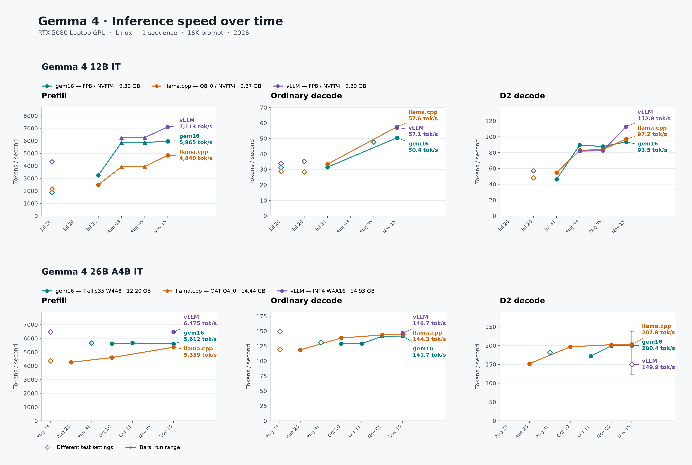

# Benchmark history, recovered 2026-11-15

August is not the start of the retained project evidence. This is a selected,
source-linked Linux time series, not an assertion that every experiment is included.
Historical files are unchanged; missing observations are not interpolated.

## Earliest evidence

- The complete, non-shallow local Git graph starts on **2026-07-21**, root commit
  `0eac7e9` (checkpoint inspector foundation). Its README calls the project `g4`,
  identifies `unsloth/gemma-4-12b-it-NVFP4`, and explicitly says inference is not
  implemented yet. `4692fcd` renames it to gem16gb on the same date. `19285ee`
  adds full greedy inference characterization on July 23; the ledger records the
  first unfused whole-engine screen on July 24.
- The oldest preserved **12B llama.cpp and vLLM speed matrices are July 21**.
  These are synthetic prompt/decode-context points, not the later 16K Wikipedia
  workload. At 8K prefill llama.cpp achieves **2,361.915 tok/s**. At 128 decode
  context it achieves **29.66885 tok/s**. The initial GGUF maps FP8 attention to
  BF16 and preserves NVFP4 MLP; its matrix uses BF16 KV. Later Q8-mapped GGUFs
  must not be described as identical tensor formats.
- The first retained three-engine **16K Wikipedia** comparison is **July 26**.
  Native/vLLM/llama use different stop-terminated output lengths; native output
  is nondeterministic in that early result. July 31 adds full fixed-1,135-output
  native and llama runs; August 3/5 contains the stronger max-power D2 comparison.
- The **26B** integration plan first appears on **August 4** (`0bb0dd1`);
  native integration commits follow on August 11. An August 4 external llama.cpp
  synthetic characterization already measures the official QAT Q4_0 checkpoint:
  **4,746.575 tok/s at 8K prefill**. This is separate from the 16K chart.
- No April/May benchmark was found in the complete local repository graph,
  preserved baseline/raw files, or the searched local Codex history. This does
  not establish that a different repository or external archive never existed.

The local chat search also finds the initialization conversation
[“Please help me setup this project. We start on an empty slate.”](codex://threads/019f85d8-1eac-7691-82fb-59345c10ae25),
source `local`, chat `019f85d8-1eac-7691-82fb-59345c10ae25`, item `item-16`,
turn `019f85fa-0626-73c3-a8bc-717081b71d16`. It records root commit `0eac7e9`.
The initial speed table is item `item-96`, turn
`019f866c-21b5-7133-a8a8-5f4a406e5feb` in that same chat. Repository records,
not chat recollection, supply the plotted numbers.

## Charts and data

The owner-requested final Reddit export incorporates the best confirmed current
12B Prefill point for each engine: 5,965.28 / 4,839.77 / 7,112.99 tok/s for
gem16 / llama.cpp / vLLM, at chunks 8192 / 1024 / 4096. The independent logical
batch/microbatch follow-up did not beat llama.cpp's 1024/1024 point. Only those
three current Prefill rows change; all historical, Decode and 26B rows remain
unchanged. These Prefill probes request one output while retaining 17,519 context;
the original full-generation cohorts remain below and in their original data.

[Final overview JPEG](../../artifacts/benchmark_history/2026-11-15/reddit-final/history.jpg) ·
[12B JPEG](../../artifacts/benchmark_history/2026-11-15/reddit-final/history-12b.jpg) ·
[26B JPEG](../../artifacts/benchmark_history/2026-11-15/reddit-final/history-26b.jpg) ·
[Final CSV](../../artifacts/benchmark_history/2026-11-15/reddit-final/history.csv) ·
[Final data and exact replacements](../../artifacts/benchmark_history/2026-11-15/reddit-final/history.json) ·
[Posting notes](../../artifacts/benchmark_history/2026-11-15/reddit-final/chart-notes.txt).
Reproduce with `tools/render_benchmark_history_reddit.py` (Matplotlib/NumPy).
The original source dataset and caption remain; duplicate PNG/SVG/PDF exports
were removed during the owner-authorized cleanup of 17 November.

The English charts contain only headings, axes, direct engine/rate labels and the
latest Target formats/file sizes (decimal GB, not VRAM or Assistant size). Explanations
are kept in this report and a separate English posting note.

Charts split 12B/26B, Ordinary/D2 and prefill. Measurement dates are equally spaced,
not a proportional calendar axis. Solid lines guide the eye between complete fixed
16K+1,135, 3+10/ABBA observations; they do not isolate source-version improvements.
Open diamonds identify stop-terminated, sampled or short-screen measurements.
Prefill uses Ordinary where available, otherwise a triangle marks a D2 prefill.
The table/dataset retain both modes. Missing D2 is absent, never a zero.

## Interpretation

Your remembered large early prefill advantage is documented for **12B**: on August 5
native prefill was 5,866.86 versus llama.cpp 3,941.23 tok/s (**+48.86%**).
vLLM was already at 6,257.37 tok/s. The corresponding D2 rates were native 87.66,
llama.cpp 83.89, vLLM 82.25 tok/s. These are not 26B measurements.

For **26B**, the August 25 to November 15 Google QAT Q4_0 llama.cpp comparison goes
from 4,262.13 to 5,358.57 tok/s Ordinary prefill (+25.73%), 118.63 to 144.33
Ordinary decode (+21.67%), and 151.92 to 202.87 D2 decode (+33.54%). The same
immutable Target and 16K+1,135 workload are retained, but runtime, driver and
speculative stream/counters changed; this is not a driver-controlled version ablation.
Native Trellis35 still retains a roughly 4.73% Ordinary prefill advantage today.

26B vLLM uses the same community INT4 W4A16 source in August and November,
but August used only 64 outputs (1+3) versus today's 1,135 (3+10). Both are
nondeterministic. Do not infer a version-only decode regression from the raw points.
See [the full current vLLM record](gemma4_26b/vllm-q4-repeat-2026-11-15.md).

## Selected measured points

All rates are median tokens/s. Every row below has machine-readable source and
JSON-pointer attribution in the downloadable data. A dash denotes an unmeasured
mode; it is not zero. All rows have a 16,384-token prompt.

### 12B

| Date | Engine | Mode | Prefill | Decode | Outputs | Samples | Notes |
|---|---|---|---:|---:|---|---:|---|
| 2026-07-26 | gem16 | ordinary | 1897.37 | 31.32 | variable 1021-1254 | 10 | stop |
| 2026-07-26 | llama.cpp | ordinary | 2160.83 | 28.84 | 1088 | 10 | stop |
| 2026-07-26 | vLLM | ordinary | 4328.03 | 33.97 | 1215 | 10 | stop |
| 2026-07-29 | llama.cpp | d2 | — | 48.38 | 1135 | 2 | screen |
| 2026-07-29 | llama.cpp | ordinary | — | 28.56 | 1135 | 2 | screen |
| 2026-07-29 | vLLM | d2 | — | 57.36 | 1135 | 2 | screen |
| 2026-07-29 | vLLM | ordinary | — | 35.30 | 1135 | 2 | screen |
| 2026-07-31 | gem16 | d2 | 3235.43 | 46.25 | 1135 | 10 |  |
| 2026-07-31 | gem16 | ordinary | 3235.82 | 31.47 | 1135 | 10 |  |
| 2026-07-31 | llama.cpp | d2 | 2473.94 | 54.70 | 1135 | 10 |  |
| 2026-07-31 | llama.cpp | ordinary | 2491.17 | 33.39 | 1135 | 10 |  |
| 2026-08-03 | gem16 | d2 | 5863.59 | 89.58 | 1135 | 10 |  |
| 2026-08-03 | llama.cpp | d2 | 3922.61 | 82.88 | 1135 | 10 |  |
| 2026-08-03 | vLLM | d2 | 6247.55 | 81.95 | 1135 | 10 |  |
| 2026-08-05 | gem16 | d2 | 5866.86 | 87.66 | 1135 | 10 |  |
| 2026-08-05 | gem16 | ordinary | — | 47.76 | 1052 | 10 | stop |
| 2026-08-05 | llama.cpp | d2 | 3941.23 | 83.89 | 1135 | 10 |  |
| 2026-08-05 | vLLM | d2 | 6257.37 | 82.25 | 1135 | 10 |  |
| 2026-11-15 | gem16 | d2 | 5951.39 | 93.50 | 1135 | 10 |  |
| 2026-11-15 | gem16 | ordinary | 5984.74 | 50.43 | 1135 | 10 |  |
| 2026-11-15 | llama.cpp | d2 | 4749.90 | 97.20 | 1135 | 10 |  |
| 2026-11-15 | llama.cpp | ordinary | 4753.98 | 57.56 | 1135 | 10 |  |
| 2026-11-15 | vLLM | d2 | 6494.41 | 112.83 | 1135 | 10 |  |
| 2026-11-15 | vLLM | ordinary | 6936.53 | 57.08 | 1135 | 10 |  |

### 26B A4B

| Date | Engine | Mode | Prefill | Decode | Outputs | Samples | Notes |
|---|---|---|---:|---:|---|---:|---|
| 2026-08-23 | llama.cpp | ordinary | 4366.58 | 119.49 | 64 | 3 | short |
| 2026-08-23 | vLLM | ordinary | 6475.80 | 149.35 | 64 | 3 | short |
| 2026-08-25 | llama.cpp | d2 | 4202.74 | 151.92 | 1135 | 10 |  |
| 2026-08-25 | llama.cpp | ordinary | 4262.13 | 118.63 | 1135 | 10 |  |
| 2026-08-31 | gem16 | d2 | 5666.39 | 182.53 | 1229 | 10 | sampled |
| 2026-08-31 | gem16 | ordinary | 5666.57 | 130.91 | 1229 | 10 | sampled |
| 2026-10-10 | gem16 | ordinary | 5623.23 | 128.96 | 1135 | 10 |  |
| 2026-10-10 | llama.cpp | d2 | 4445.20 | 196.85 | 1135 | 10 |  |
| 2026-10-10 | llama.cpp | ordinary | 4607.79 | 138.46 | 1135 | 10 |  |
| 2026-10-11 | gem16 | d2 | 5665.47 | 172.31 | 1135 | 10 |  |
| 2026-10-11 | gem16 | ordinary | 5665.11 | 129.09 | 1135 | 10 |  |
| 2026-11-05 | gem16 | d2 | — | 199.60 | 1135 | 20 |  |
| 2026-11-05 | gem16 | ordinary | — | 141.37 | 1135 | 20 |  |
| 2026-11-05 | llama.cpp | d2 | — | 202.38 | 1135 | 20 |  |
| 2026-11-05 | llama.cpp | ordinary | — | 143.58 | 1135 | 20 |  |
| 2026-11-15 | gem16 | d2 | 5632.00 | 200.40 | 1135 | 20 |  |
| 2026-11-15 | gem16 | ordinary | 5612.11 | 141.74 | 1135 | 20 |  |
| 2026-11-15 | llama.cpp | d2 | 5355.65 | 202.87 | 1135 | 20 |  |
| 2026-11-15 | llama.cpp | ordinary | 5358.57 | 144.33 | 1135 | 20 |  |
| 2026-11-15 | vLLM | d2 | 4097.94 | 149.87 | 1135 | 20 | memory-fit |
| 2026-11-15 | vLLM | ordinary | 6475.09 | 146.67 | 1135 | 10 |  |

## Current 12B protocol

The current 12B run uses the existing immutable mixed FP8/NVFP4 Target
`unsloth/gemma-4-12b-it-NVFP4@b1f649734b34aa5575b03d186abd1b9be3d0d5c4`
and the official BF16 Assistant
`google/gemma-4-12B-it-assistant@364bd03c9952e5b7da73665ee30c9eccfc408345`.
The native and external 12B NVFP4 paths are the historical 12B profile; the
separate new **26B vLLM comparison uses INT4, not NVFP4**.

Fresh native / central llama.cpp / vLLM 0.33.0 cohorts each receive the exact
16,384 prompt IDs, generate 1,135 fixed greedy outputs, seed0, suppress IDs
1/50/106/258882/258883, batch1, no prefix reuse, requested context17,519.
Each engine/mode uses3 warmups and10 retained runs, run serially after cooling
to at most50°C. Native/vLLM useFP8 KV, llama usesQ8_0 KV and padded context17,664,
8threads and2,048/512 batch/ubatch. vLLM uses1,024-token chunked prefill and
0.90 GPU memory budget, no CPU weight offload; all three keep per-token model
weights on the GPU. The driver is620.70.06 and firmware max-power/nvidia-powerd
are active. Native is the existing November5-qualified executable (same binary
as today's26B control), local runtime source58febf4; the two newer remote-main
commits change release/tests/docs rather than runtime. The comparison is not
an interleaved three-engine ABBA campaign.

[Current 12B raw-sample/identity/telemetry record](../../artifacts/benchmark_history/2026-11-15/current-12b.json)
retains every sample and the command, binary/model/hash and actual-dispatch
provenance. The separate traces are diagnostic; their timings are excluded. Native and vLLM have new12B traces. The later llama-specific profile attempt was stopped by the freshness guard when upstream advanced fromde32b26 to900f01b; the only changed file is the AMD-HIP CI script`scripts/hip/gcn-cdna-vgpr-check.py`. No new12B-specific llama CUDA invocation trace or fully qualified three-engine baseline is claimed. The completed unprofiled runs passed their launch freshness checks and retain the exactde32b26 identities; CUDA/inference sources are unchanged by the newer CI commit.
Native Ordinary and D2 output hashes must match. Cross-engine and external
Ordinary/D2 equality is not assumed. No model quality or version-only claim follows.

## Format and timing boundaries

12B native and vLLM load the immutable mixed FP8/NVFP4 source. Historical/current
llama.cpp converts FP8 attention to BF16 or Q8_0, preserves NVFP4 MLP and uses
Q8_0 KV in the Wikipedia tests. Native/vLLM use FP8 KV. 26B native is **Trellis35
W4A8**, llama.cpp is **Google QAT Q4_0**, vLLM is **community INT4 W4A16**; these
are different checkpoints/activation formats. The retained internal 26B NVFP4
profile is deliberately not spliced into the Trellis35 line.

Cross-engine tokens differ. External speculative output can differ from its own
Ordinary output. Prefill/TTFT boundaries are engine-specific; early stop handling,
sampling and fixed-output changes are recorded per point. Historical Windows
results remain in their original files and are excluded from this Linux time series.
Power policy, clocks, driver, toolchain, warmups and output determinism differ
between dates. This chart shows observed performance evolution, not identical
quality, identical arithmetic or controlled attribution to one implementation change.

## Reproduce extraction

Local raw scripts:
`benchmarks/results/2026-11-15/58febf4/history-and-12b/`:
`run.py` records new 12B commands/telemetry; `export_history.py` validates every
plotted value against its source JSON pointer; `plot_history.py` uses Matplotlib
3.11.2 to produce PNG/SVG/PDF; `write_report.py` generates this report.
Raw inputs under ignored `benchmarks/results/` are required for a complete rerender.
All source file SHA-256 identities are in `history.json`. No historical file is rewritten.

## 26B D2 memory follow-up

The original startup OOM is resolved with public TorchInductor mode0 while retaining full CUDA Graphs, the same INT4 W4A16 Target, full context and GPU residency. The final official base BF16 Assistant matches the INT4 model-card source. D2 median149.873tok/s over20retained samples; the plot shows the observed run range because outputs and acceptance vary strongly. D2 uses128-token prefill chunks/384MiB KV rather than Ordinary1024/512MiB. Explicit W4A8 via Humming fails model construction, so it provides no speed point. See the [full follow-up](../../artifacts/vllm/gemma4-26b-d2-memory-followup-2026-11-15.json).
