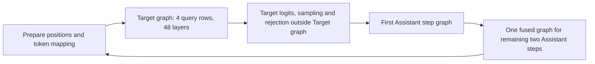

# 12B vLLM trace alignment — 2026-11-17

Actual warmed vLLM D3/D2 and native D2 traces identify GPU kernel work,
rather than a missing native D2 CUDA Graph, as the main execution gap.
Two exact native changes are retained locally: T3 post-attention boundary
fusion and a fixed-shape T3 Down kernel. The final unprofiled median is
**99.0064 output tok/s**, versus the starting parent **94.1059** pooled
median: **+5.2074%**. This does **not** reach the historical vLLM D3
117.4100 tok/s. No additional native D4 performance benchmark was run.

Raw root (`R` below):
`benchmarks/results/2026-11-17/vllm-alignment/`.
Task authorization/scope:
`docs/plans/gemma4-12b/VLLM_TRACE_ALIGNMENT_2026_11_17.md`.
There is no commit, push, release, model conversion or checkpoint change.

## Matched workload and identities

- RTX 5080 Laptop, SM120,16,303 MiB; driver620.70.06; CUDA13.4.92;
  GCC16.2.1; Release C++20, `compute_120a/sm_120a`, RDC. Native toolchain
  and GPU queries are in `R/toolchain.json` and `R/hardware.csv`.
- Target `unsloth/gemma-4-12b-it-NVFP4` at
  `b1f649734b34aa5575b03d186abd1b9be3d0d5c4`; official BF16 Assistant
  `google/gemma-4-12B-it-assistant` at
  `364bd03c9952e5b7da73665ee30c9eccfc408345`.
- `benchmarks/prompts/wikipedia-summary-16k.json`: the same16,384 prompt
  IDs,1,135 fixed outputs,1,134 timed decode intervals, context17,519,
  batch1, greedy, suppression1/50/106/258882/258883, FP8 KV, no prefix reuse
  or CPU weight offload. Checkpoints and weights remain GPU-resident.
- Worktree base `81118043fb526a8f86f07f030d53d9ddbd5b7104` was dirty at
  entry. The pinned starting executable SHA256 is
  `23b9bbf01eea186553015c49005906145c7b55be615d7158a54ff0180733a38c`.
  Its matched binary/static-library set is in `R/production-parent/`.
- Final executable SHA256:
  `4035ebba761e666fdd60ff3293bf27d780fff8347e3932087335856f8f683d10`.
  Final matched binaries/core library are in
  `R/down-fixed/integration/production-candidate/`. Canonical CLI/chat,
  CUDA/host tests and server were built locally. Server version remains
  the current build's0.2.1; this task changes no product version.
- Installed reference: vLLM0.33.0, PyTorch2.14.0, Transformers5.20.2,
  FlashInfer0.7.2.post1, Triton3.8.0, compressed-tensors0.17.0.
  The preceding installed-source manifest is
  `artifacts/dflash/2026-11-16/vllm-source-manifest.json`, aggregate
  `4584b0367bdebfec43afbef57dc720478ed85e9e142232275072d250b35be609`.
  Today uses that installation without package/source modifications;
  `R/vllm-source-recheck.json` verifies all3,231 recorded Python files.

`R/scope-audit.json` verifies every initial tracked dirty patch is byte
identical. Of the source archive's files, only the five owned production
files change;242 others remain identical. Generated headers are produced
by their repository generators. Source snapshots, hashes and binary
identities accompany the raw evidence.

## Captures and timing boundaries

vLLM uses the torch worker profiler with detailed step annotations,
one full warmup,32 skipped worker iterations and16 recorded decode steps.
The profiler wrapper is `tools/profile_12b_vllm_decode.py`. Each diagnostic
has one retained profiled request, not a primary throughput cohort.
The annotations prove zero prefill requests and one generation request:

| Trace | Query rows | First/last annotated KV length | Recorded groups |
|---|---:|---:|---:|
| vLLM D2 |3|16,426–16,458|16|
| vLLM D3 |4|16,431–16,472|16|

Native uses Nsight Systems2026.5.2 CUDA/NVTX tracing, node-level graph
events, and the `gem16.mtp.fixed_d2_chain` NVTX capture range. The analysis
selects groups16–31 from507 observed group boundaries, excluding prompt
processing, initialization and the terminal tail. Parent and final traces
use the same capture command and window rule.

Run records:
`R/vllm-d{2,3}-profile.{json,log}`, `R/vllm-d{2,3}-traces/`,
`R/native-{parent,candidate}-d2-capture.{command.json,nsys-rep,sqlite}`.
`tools/analyze_12b_vllm_alignment.py R` produces
`R/trace-comparison.json` and the four ordered `*-timeline.csv` files,
including each kernel's time, graph ID, grid, block, registers and shared
memory. Exact profiling/export commands are stored beside each capture.

These are **diagnostic profiler timings**, with different instruments and
slightly different request states/positions. They prioritize opportunities;
they are not primary benchmark rates or an exact causal decomposition of
the117tok/s result. In particular, the Nsight capture/shutdown inflates
the native engine JSON's reported decode time. All profiled request rates
and all interposed runs are excluded from primary timing.

## What vLLM actually executes

The startup and actual dispatch agree on TRITON_ATTN for both Target and
Assistant, CUTLASS FP8 projections, and FlashInfer/CUTLASS NVFP4 matrix
multiplication. FlashInfer's presence does not establish FlashAttention,
XQA or another attention backend.

One captured D3 cycle is:

There are48 graph launches over16 D3 cycles: three per cycle. Actual graph
IDs in this capture are1247 for Target,1310 for the first Assistant step,
and1313 for remaining draft steps. Target has768 attention invocations,
the first-step graph64 and the remaining-step graph128. Thus the fused
remaining-steps route is **observed**, resolving the source-only uncertainty
from the November16 audit. D2 also has three launches/cycle; its remaining
graph has64 attention calls. Graph IDs are capture-local identities.

Within a Target layer the chronological trace shows:

1. Fused RMS/FP8 activation preparation, CUTLASS grouped QKV/Q projection.
2. Q/K/V normalization, RoPE and cache preparation, with Inductor fusions.
3. `reshape_and_cache_kernel_flash` then `kernel_unified_attention` and
   `reduce_segments` on the FP8 KV cache.
4. Attention-output FP8 quantization and CUTLASS O projection.
5. `triton_red_fused_add_rms_norm_scaled_fp4_quant_1`, FP4 format preparation,
   block-scaled Gate/Up GEMM.
6. `triton_poi_fused_gelu_mul_scaled_fp4_quant_slice_2`, FP4 preparation,
   block-scaled Down GEMM, then the next residual/norm boundary.

Actual launch geometries, not merely class names:

| Target operation | vLLM | Native starting parent |
|---|---|---|
| Local attention |grid1×8×16,128threads;192registers|split64CTAs×256threads;108registers, then merge16×3|
| Global attention |D2 grid4×1×16; D3 grid5×1×16,128threads;254registers|split35×3CTAs×256threads;64registers, then merge16×3|
| NVFP4 Gate/Up |grid240×1×1,384threads|grid960×1×1,64threads; fused GELU/product|
| NVFP4 Down |grid1×30×1,384threads|grid60×1×1,256threads|

The observed CUTLASS block-scaled operators are SM120 TMA warp-specialized
kernels. Their30/240 CTA geometries cover128 logical output channels/CTA;
internal CUTLASS M/N swapping must not be confused with logical projection
axes. This is not proof of every tactic/inner-loop parameter. No hardware
stall-counter/NCU diagnosis or direct vLLM-cubin-to-instruction mapping was
performed.

The BF16 Target head uses a CUTLASS WMMA kernel outside the captured Target
graph. Sampling, rejection and request metadata kernels also remain outside
that graph. The native head is already competitive; moving that particular
vLLM implementation into gem16 is not supported by these costs.

The installed Triton attention source uses tiled `tl.dot` QK and PV,
segment softmax and reduction. The actual grid confirms16 segments. Native
local/global fixed-D2 kernels preserve FP32 SIMT FMA/reduction order. A
literal tensor-core attention port would change numerical operations and
must not silently replace the exact native contract. No such port is made.

## Kernel costs and the remaining gap

Milliseconds/group over the16 captured groups; these coarse families are
not identical fusion boundaries. Native Gate/Up includes GELU/product;
vLLM has a separate GELU/Down-quant kernel. Assistant includes its head.

| Family | Native parent D2 | Native final D2 | vLLM D2 | vLLM D3 |
|---|---:|---:|---:|---:|
| Assistant, all steps |3.019|3.097|2.850|4.295|
| Target attention |3.307|3.391|2.157|2.394|
| Target Down |4.095|2.684|2.328|2.359|
| Target FP8 QKV/O |3.426|3.508|3.867|3.927|
| Target Gate/Up |4.115|4.243|4.565|4.632|
| vLLM separate GELU/Down-quant |—|—|0.082|0.084|
| Target norm/quant/RoPE |2.347|2.208|0.970|0.982|
| Target KV kernels |0.280|0.282|0.081|0.083|
| Target head/selection |2.505|2.517|2.657|2.679|

Native parent's selected window is377.247ms, kernel-busy union371.062ms,
non-kernel interval6.186ms (**1.640%**). Final is358.493ms. vLLM D2/D3
windows are316.326/347.004ms. Non-kernel intervals include copies and
device graph scheduling as well as possible host gaps; this is not a CPU
overhead counter. Unchanged kernel families also vary in time between
captures, so the per-family deltas are not all code-caused speedups.

Native D2 already uses a device-controlled conditional graph for the
request and has no per-group host decision/synchronization requirement.
Emulating vLLM's Python orchestration or three separate replay calls is
therefore not the priority. The remaining matched-D2 cost gaps are mainly
attention and the other norm/quantization boundaries; Down is much closer.

The historical117.4100tok/s D3 cohort has445 groups,689 accepted drafts
and1,134 decode intervals: **2.5483 outputs/group**,21.690ms/group. Native
D2 has507 groups and626 accepted drafts, plus its initial/tail accounting;
its effective1,134/507 interval ratio is2.2367. D3 benefits from more
useful outputs per verifier call. This is not117 full Target passes/s.
The cross-engine output sequences differ and their acceptance ratios are
not exact parity. The historical vLLM D2 median remains112.8263tok/s;
no new primary vLLM throughput controls were requested or run today.

## Retained changes and rejected screens

**T3 boundary fusion.** Extend the qualified T1 post-attention fusion as
three independent256-thread CTAs. Preserve the exact projection BF16
round, postnorm tree, residual round, pre-MLP tree and NVFP4 scale/packing.
Select only12B T3 MTP verification with checkpoint-FP8 KV. Optional discarded
postnorm output is not written; the hidden/packed/scales results are exact.
Three kernels/layer become one. A final16-group trace contains exactly
768 new T3 calls, removing1,536 calls (96/group); every other family count
is unchanged. Total events19,152→17,616. T3 actual grid3×1×1, block256,
64registers and1,024shared bytes in CUPTI.

**Fixed Down shape.** Select only T3/N3840/K15360 in the BF16-output
NVFP4 batch launcher. Keep60CTAs,256threads, N8/warp, existing resident
weight/SFB layout, sequential K64 MMA accumulation, division and BF16
epilogue. Specialize valid/zero operands and32bit index arithmetic.
All768 observed Down calls use `Sm120D2DownFixedShapeKernel`. Registers
fall64→43, CUPTI shared bytes remain0. The production SASS contains
`OMMA.SF.16864.F32.E2M1.E2M1.UE4M3.4X`; object reports show zero local/stack
for both retained kernels. Raw object resource reports list1,024 more
shared bytes than CUPTI for these kernels; both raw reports are retained,
and the table above uses the actual CUPTI launch fields.

The production bodies match their numerically tested offline bodies, and
both headers regenerate exactly. No weight layout/repack, arena, allocation,
context, scale, cache-transaction or output-policy change is introduced.
Ordinary, D1/D4, Prefill and26B dispatches stay on their previous paths;
the fixed Down shape also supports the existing12B BF16-KV T3 diagnostic
route, which is separately checked.

| Offline screen | Warm throughput change | After256MiB eviction | Decision |
|---|---:|---:|---|
| Shared activation/SFA cache |+0.772%|−0.494%|reject; no integration|
| Two N8 tiles/warp, four warps |−31.182%|−26.240%|reject; no integration|
| T3 boundary fusion |+49.379%|+1.275%|qualified and retained|
| Fixed Down, parent geometry |+31.064%|+20.723%|qualified and retained|

These are paired kernel replay screens,15 micro-sample pairs per actual
case, not full-request benchmark cohorts. Negative trials stay under
`R/down-cache/` and `R/down-dual/`; the production source contains neither.

## Unprofiled throughput

Each full-request cohort uses the owner's **one warmup + three retained
requests**. No profiler or LD_PRELOAD is used. GPU jobs are serialized,
with cooling to≤50°C before a cohort and200ms NVML telemetry. The small
fusion effect is checked in both orders. Its fresh parent measurements
are reused for the final Down component; no unnecessary control cohort
or native D4 throughput run is added.

| Cohort | Three raw decode tok/s | Median |
|---|---|---:|
| Starting parent, AB |94.182135,94.137570,94.066510|94.137570|
| Fusion, AB |94.786730,94.696495,94.685426|94.696495|
| Fusion, BA |94.759008,94.712313,94.626168|94.712313|
| Starting parent, BA |94.164930,94.074314,94.050907|94.074314|
| Fusion + fixed Down |99.156210,99.006443,98.956334|99.006443|

Starting pooled median94.105942; fusion pooled median94.704404. Combined
gain is5.207430% over the starting pooled median and4.542596% over the
fusion pooled median. The final combination has one three-request cohort,
not a combined ABBA/statistical-population guarantee.

Every retained request has1,135 identical output IDs,507 groups,1,014
proposals,626 accepted drafts, zero fallback and no token-loop allocation.
Sampled peak VRAM is11,763MiB for all native cohorts. Engine arenas remain
weights9,304,895,488bytes, KV311,287,808bytes, workspace1,606,853,120bytes,
decode graph25,165,824bytes, persistent repack0. vLLM diagnostic sampled
peak is14,661MiB with `gpu_memory_utilization=0.9`; its pool policy differs.
NVML peaks are200ms samples rather than instantaneous allocator maxima.

Commands/results: `R/run_screen.py`, `R/screen-d2-*.{command.json,json}`,
`R/down-fixed/integration/{run_screen.py,screen-d2-candidate.*}`. The
recorded command arrays are the exact invocations, including model paths.

## Correctness, resource and scope gates

- Fusion:12 fresh actual fixtures (layers0/15/31/47, groups0/250/506),
  all three rows, null/non-null post-output and separate/aliased hidden
  output, plus finite/rounding boundaries:120 exact comparisons.
- Fixed Down:12 unchanged-source immutable actual Down fixtures and
  finite/zero/sign/extreme cases:84 exact comparisons. Parent output also
  matches each recorded expected fixture before candidate comparison.
- Both candidates pass compute-sanitizer memcheck, synccheck and racecheck
  with zero errors/hazards. Guards and unchanged inputs are checked. These
  memory checks cover the isolated operators, not a full1135-token
  end-to-end sanitizer run.
- For fusion and then final combination separately: diagnostic Ordinary
  and D2 parent/candidate requests preserve all1,135 IDs, all1,014 D2
  proposal IDs, transaction counters and the entire311,287,808-byte Target
  KV arena. Ordinary/D2 all share SHA256
  `6b03676412022f6be775dfec7ec4e9e68ef3d997a28e6f5f3f100ff36c577231`.
- Final36 protected executions (18 parent/candidate pairs):12B text
  D0/D1/D2/D4, BF16-KV D0/D2,
  cached/reset/cancel/relaunch sessions, live12B image/audio D0/D2,
  Compact Vision image/text and internal26B NVFP4 text D0/D2. Short D4
  correctness checks are not D4 performance benchmarks. Media comparison
  covers exact live UTF8 responses, not a raw media token-ID parity claim.
- Final `gem16-cuda-tests` and `gem16-unit-tests`: pass. Native CLI/chat,
  tests and `gem16-server` build successfully. Linux only; no Windows,
  Studio UI, long-context capacity, probabilistic-quality or release
  campaign is claimed. Cancellation behavior is matched to parent, not
  newly qualified as universally supported.
- Actual final Nsight dispatch and source/SASS/resource evidence support
  the two kernel changes. All owned GPU jobs are stopped at completion.

Exact command arrays, logs and summaries are in
`R/{norm-t3,down-fixed}/`, `R/{state,protected}.json`, and
`R/down-fixed/integration/{state,protected}.json`. The state interposer
is diagnostic-only. Primary timing never uses it.

## Next implementation boundaries

The next evidenced kernel targets are the remaining multi-row norm/FP8
quantization boundaries and attention (about1.2ms/group each versus vLLM
D2 in this diagnostic window). Preserve exact native trees and cache
transactions when combining boundaries; deleting rollback/cache copies
or adopting Triton's different dot-product arithmetic is not a free
execution-only change. A native GPU-controlled D3/D4 request chain would
address a separate amortization advantage. It requires implementation and
its own qualification; neither the existing host-driven D4 path nor a
117tok/s native result is asserted here.
